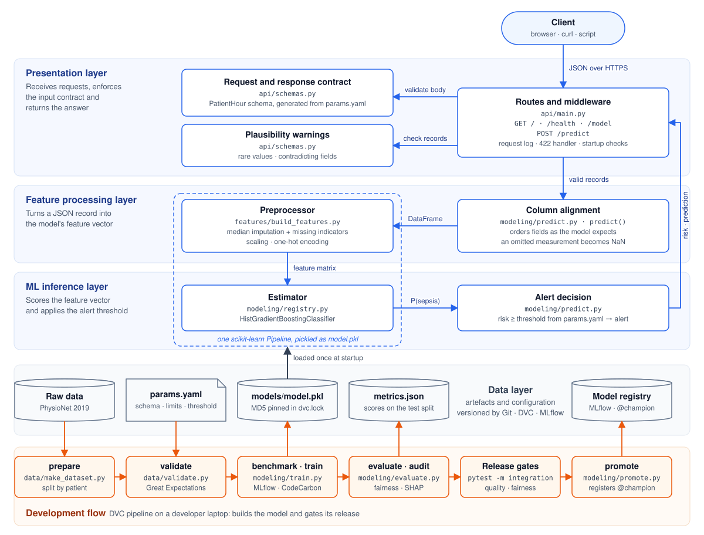
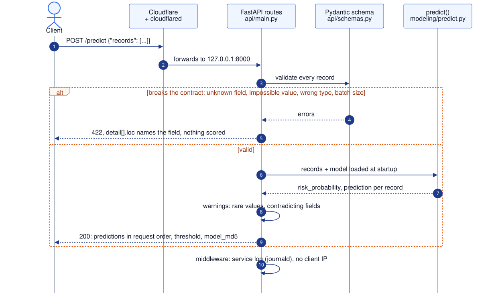
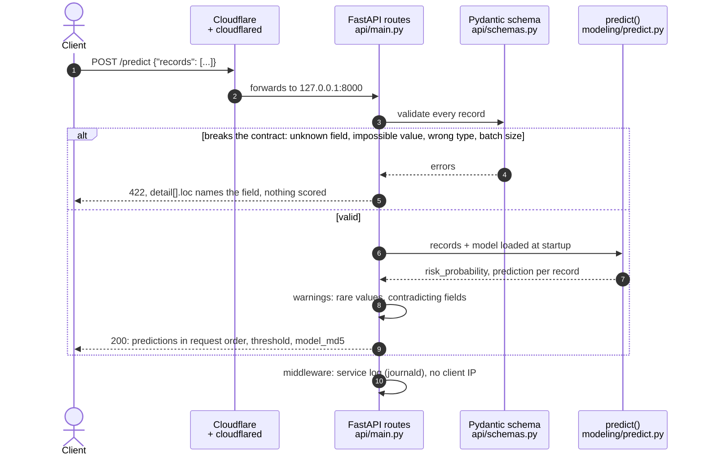
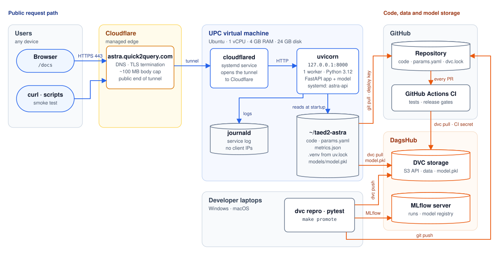

# System design

This page describes how Astra is built, in two views:

- the [logical architecture](#logical-architecture): which parts the system has and how they talk to each other;
- the [physical architecture](#physical-architecture): where each part runs.

How to call the API is in [api.md](api.md), and how to run it on the VM in [deployment.md](deployment.md).
The two architecture diagrams are SVG files in [images/](images/) and can be edited directly. The request
flow is generated from the Mermaid source further down.

## Logical architecture

The system has two parts that meet at the trained model, `models/model.pkl`:

- The **runtime flow** (blue) is the API. A request goes down through the layers and the answer goes
  back through the routes.
- The **development flow** (orange) is the DVC pipeline that builds the model. Each artefact it writes is
  drawn just above the stage that writes it.

Both parts read `params.yaml`. The training data is validated against it, the API generates its request
schema from it, and the alert threshold comes from it.

### Layers

| Layer | What it does | Code |
|-------|--------------|------|
| Presentation | Receives the request, validates it and returns the answer | `api/main.py`, `api/schemas.py` |
| Feature processing | Turns each record into the feature vector the model expects | `modeling/predict.py`, `features/build_features.py` |
| ML inference | Computes the sepsis probability and applies the threshold | `modeling/registry.py`, `modeling/predict.py` |
| Data | Configuration and artefacts | `params.yaml`, `models/model.pkl`, `metrics/metrics.json`, MLflow |

The preprocessor and the estimator are in different layers, but they are saved together: `build_model()`
puts both in one scikit-learn `Pipeline`, and that pipeline is what `train` pickles as `model.pkl` (the
dashed box in the diagram). This way the API always preprocesses the data exactly as it was done when the
model was evaluated.

### Components

| Layer | Component | Code | Responsibility |
|-------|-----------|------|----------------|
| Presentation | Routes | `api/main.py` | Endpoints `/`, `/health`, `/model` and `/predict`. Loads the model at startup, logs each request and returns a short `422` when the input is wrong |
| Presentation | Request and response schemas | `api/schemas.py` | `PatientHour` (one record), `PredictionRequest`, `PredictionResponse`, `ModelInfo`, `HealthResponse`. `PatientHour` is built from `params.yaml` |
| Presentation | Warnings | `api/schemas.py` | Flags values outside `validation.ranges` and fields that contradict each other (for example DBP above SBP). The record is still scored |
| Feature processing | Column alignment | `predict()` in `modeling/predict.py` | Puts the fields in the order of the model's columns; a missing measurement becomes NaN. The `evaluate` stage uses the same function |
| Feature processing | Preprocessor | `build_preprocessor()` in `features/build_features.py` | Median imputation with missing-value indicators, scaling and one-hot encoding. Columns are selected by type, not by name |
| ML inference | Estimator | `modeling/registry.py` | The model chosen in `params.yaml` (`train.model`). Right now a `HistGradientBoostingClassifier` |
| ML inference | Decision | `predict()` in `modeling/predict.py` | Returns `risk_probability`, and `prediction = 1` when it is at or above `evaluate.threshold` |
| Data | Configuration | `params.yaml`, `config.py` | All tunable values and all paths |
| Data | Artefacts | `models/model.pkl`, `metrics/metrics.json` | The model (its MD5 is in `dvc.lock`) and its scores on the test split |
| Data | Model registry | MLflow on DagsHub | Training runs, and the approved model under the alias `@champion` |
| Development | Pipeline | `dvc.yaml` | `prepare → validate → benchmark / train → evaluate → fairness, explain, co2_report, plots` |
| Development | Release gates | `tests/test_model_quality.py`, `tests/test_explainability.py` | Minimum performance, gaps between subgroups, fairness and clinical direction checks |

### Interfaces

| Interface | Between | What is agreed |
|-----------|---------|----------------|
| `POST /predict` | Client and API | Body `{"records": [...]}` with 1 to `api.max_batch_size` records. The answer has one prediction per record, in the same order, plus `threshold` and `model_md5`. If any record is invalid the API returns `422` and scores nothing |
| `GET /model` | Client and API | Name, MD5, threshold, accepted fields and test metrics of the model being served |
| `GET /health` | Client and API | `200` while the service is running. Since the service only starts with a valid model, this also means it can predict |
| `PatientHour` | `params.yaml` and API | Fields from `validation.ranges`, required fields from `validation.complete`, bounds from `api.limits`. Unknown fields, text and NaN are rejected |
| `model.pkl` | Pipeline and API | A fitted `Pipeline` whose input columns are exactly the keys of `validation.ranges`. The API checks this at startup and does not start otherwise |

### Data flows

**Development flow.** `prepare` splits the data by patient, so no patient is in both train and test.
`validate` checks both splits with Great Expectations and stops the pipeline if a critical check fails.
`benchmark` compares the candidate models with grouped cross-validation, and `train` fits the one chosen
in `params.yaml` and logs it to MLflow. `evaluate`, `fairness` and `explain` measure the model on the test
split. If the release gates pass, `make promote` registers the model as `@champion`.

**Runtime flow.** This is what happens with one request:

If the request breaks the input rules, the API answers `422` with the field that failed and does not score
anything. If it is valid, the model loaded at startup scores every record, and the answer includes the
warnings and the `model_md5` of the model.

Mermaid source

### Patterns

| Pattern | Where |
|---------|-------|
| Model as a service | The model is loaded inside the API and used through REST, so a client only needs HTTP |
| Layered architecture | Routes and schemas, then preprocessing, then the model. The schemas can be tested without the model |
| Stateless client-server | No database and no patient history: each patient-hour is scored on its own, as in training |
| Pipeline (pipes and filters) | The DVC stages: each one has declared inputs and outputs, and `dvc repro` only reruns what changed |
| Single source of truth | `params.yaml` defines the fields for both training and the API |

### Design decisions

| Decision | Reason |
|----------|--------|
| A REST API that scores a batch per call | The patients of a ward for one hour fit in one request |
| The API never trains | It only loads `model.pkl`, which is the exact file the release gates tested. It does not need the training data |
| `model_md5` in every response | Any prediction can be traced back to `dvc.lock`, and from there to the commit and the MLflow run |
| Preprocessing inside the pickled `Pipeline` | Serving cannot drift from what was evaluated |
| The API does not start without a valid model | A deployment error appears once, at startup, instead of on every request |
| Reject impossible values, warn about rare ones | `api.limits` is wider than `validation.ranges` because very sick patients have extreme values and still need a score. A wrong unit or a misspelled field is rejected |
| A model registry, but no queue or feature store | `make promote` keeps the approved model and its history in MLflow. A queue or a feature store would not solve any problem we have |
| No authentication | It is a teaching project with no real patient data behind it. A real deployment would need authentication and rate limiting |

## Physical architecture

Users reach the API through Cloudflare, which forwards the requests through a tunnel to a UPC virtual
machine. The VM only serves the API: it does not train and it has no data. It gets the code from GitHub
and the model from DagsHub. The model is trained on our laptops, and CI runs on GitHub Actions.

### Nodes

| Node | What runs there | Details |
|------|-----------------|---------|
| User devices | Browser on `/docs`, `curl`, scripts, the smoke test | Anything that can send HTTPS |
| Cloudflare | DNS for `astra.quick2query.com`, TLS and the public end of the tunnel | Managed service |
| UPC VM | `cloudflared` and `uvicorn`, both as systemd services | Ubuntu, 1 vCPU, 4 GB RAM, 24 GB disk, Python 3.12. Environment installed with `uv sync --frozen --no-dev` |
| Developer laptops | DVC pipeline, tests, `make promote` | Windows and macOS, same environment from `uv.lock` |
| GitHub | Repository and CI (GitHub Actions, `ubuntu-latest`) | Managed service |
| DagsHub | DVC remote (S3 API) and MLflow server with the model registry | Managed service |

### Where each logical component runs

| Logical component | Where |
|-------------------|-------|
| Routes, schemas, preprocessing, model, decision | One uvicorn worker on the VM |
| `model.pkl` | In memory in that worker, read from `~/taed2-astra/models/`. Stored in DagsHub |
| `params.yaml`, `metrics.json` | Git checkout on the VM. Stored in GitHub |
| DVC pipeline | A developer laptop |
| Release gates | A laptop before `make promote`, and GitHub Actions on every pull request |
| Model registry and experiment tracking | MLflow on DagsHub |
| Raw data and splits | DagsHub and the laptops, never the VM |

### Network

| Connection | Protocol |
|------------|----------|
| Client to Cloudflare | HTTPS |
| Cloudflare to the VM | Cloudflare tunnel. `cloudflared` opens the connection from the VM to Cloudflare |
| `cloudflared` to uvicorn | HTTP on `127.0.0.1:8000`. uvicorn only listens on localhost, so the API can only be reached through the tunnel |
| SSH to the VM | Also through the tunnel, with the hostname `ssh-astra.quick2query.com` and `cloudflared access` |
| VM to GitHub | SSH with a read-only deploy key, when running `make deploy` |
| VM, laptops and CI to DagsHub | HTTPS |

### Storage

| What | Where | Versioned with |
|------|-------|----------------|
| Code, `params.yaml`, `dvc.lock`, metrics and reports | GitHub | Git |
| Raw data, splits and `model.pkl` | DagsHub (DVC) | DVC, through the MD5s in `dvc.lock` |
| Training runs and registered models | DagsHub (MLflow) | MLflow runs and registry versions |
| Service log | journald on the VM | Not versioned |

### Operations

| Topic | How we do it |
|-------|--------------|
| Releasing | Pull request, CI, review, merge, `make promote` on a laptop, then `make deploy` on the VM (pulls code and model, restarts the service and runs the smoke test) |
| Capacity | One worker on one vCPU. In our load test the limit was about 25 requests per second with 10 records each ([deployment.md](deployment.md#measured-capacity)) |
| Availability | systemd starts both services at boot and restarts uvicorn 10 seconds after a crash |
| Monitoring | `GET /health`, `GET /model` to see which model is live, and `make logs` / `make status` on the VM |
| Secrets | DagsHub token in `.env` and `.dvc/config.local` on the laptops, only in `.dvc/config.local` on the VM, and as a repository secret in CI. Read-only deploy key for GitHub. Tunnel token in the `cloudflared` service. Nothing in Git |

CI checks the data contract, the release gates and `dvc status` only when the `DAGSHUB_TOKEN` secret is
set, because it needs to download the data and the model.

### Design decisions

| Decision | Reason |
|----------|--------|
| No training on the VM | The VM downloads the exact `model.pkl` in `dvc.lock`, the one that passed the gates. The full dataset would also not fit comfortably in 4 GB of RAM |
| No data on the VM | The API does not need it, and a public server should not store patient records |
| Cloudflare tunnel | Gives a public HTTPS address to a VM inside the university network, without managing certificates on the VM |
| No reverse proxy | uvicorn only listens on localhost and the tunnel is the only way in. The downside is that the VM does not limit the request body size; Cloudflare's limit covers it ([deployment.md](deployment.md#measured-capacity)) |
| systemd instead of `nohup` or `tmux` | The service survives logouts, reboots and crashes, and the logs go to journald |
| One worker | The VM has one CPU, and each worker loads its own copy of the model |
| No Docker | It is one service on one VM. `uv sync --frozen` already installs the exact versions, including the scikit-learn version used to pickle the model |
| No client IPs in the logs | uvicorn runs with `--no-access-log` and the app only logs method, path, status and latency. IPs are personal data that we do not need |
